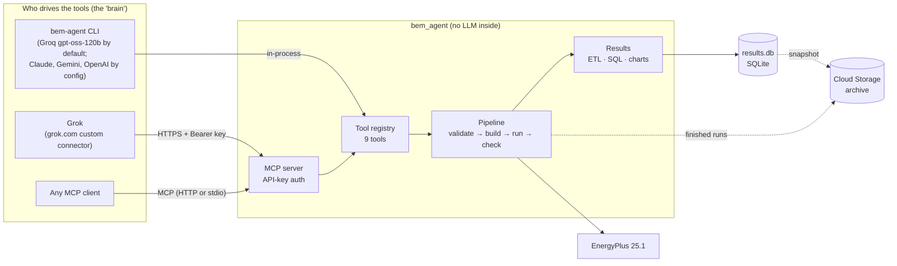
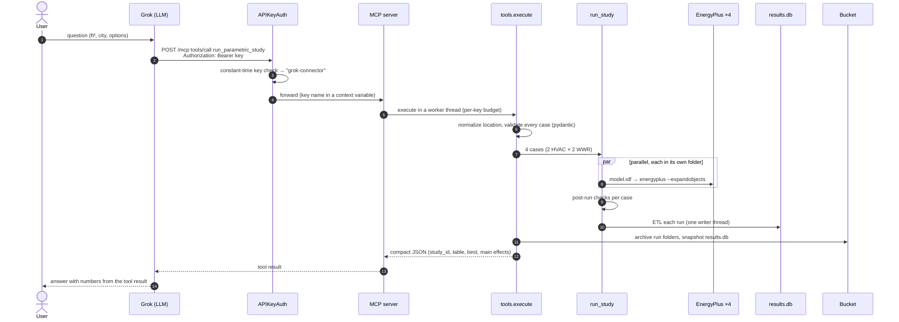
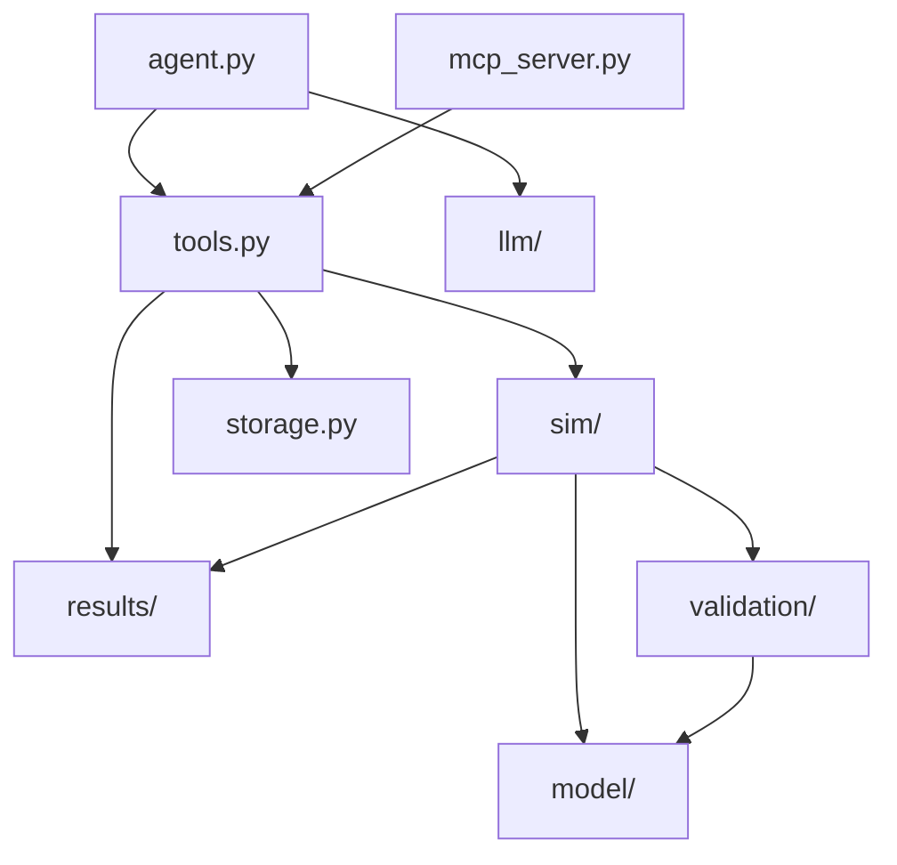
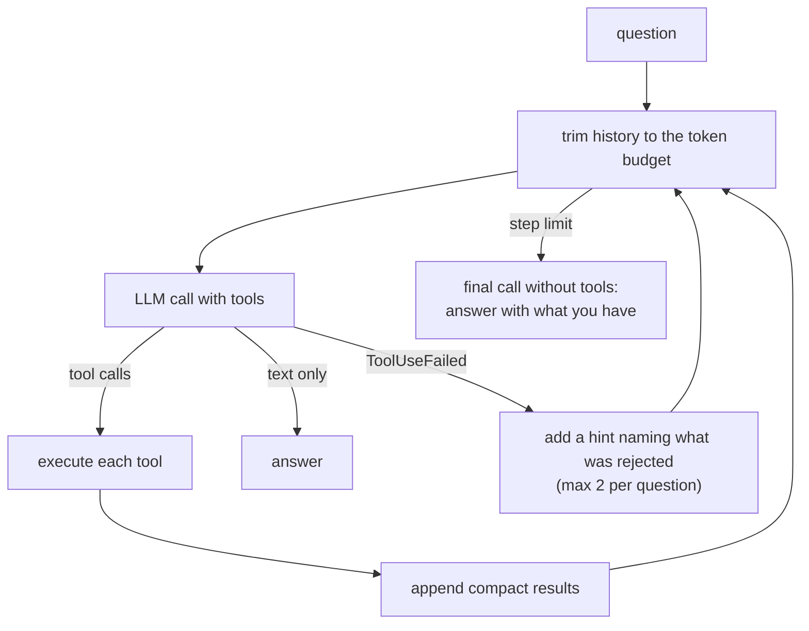
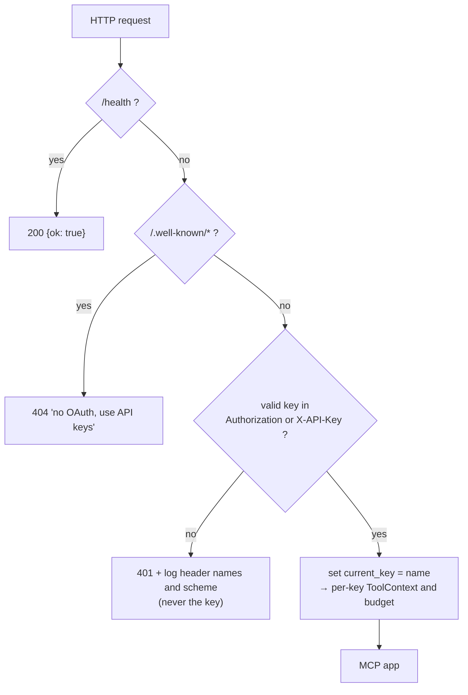
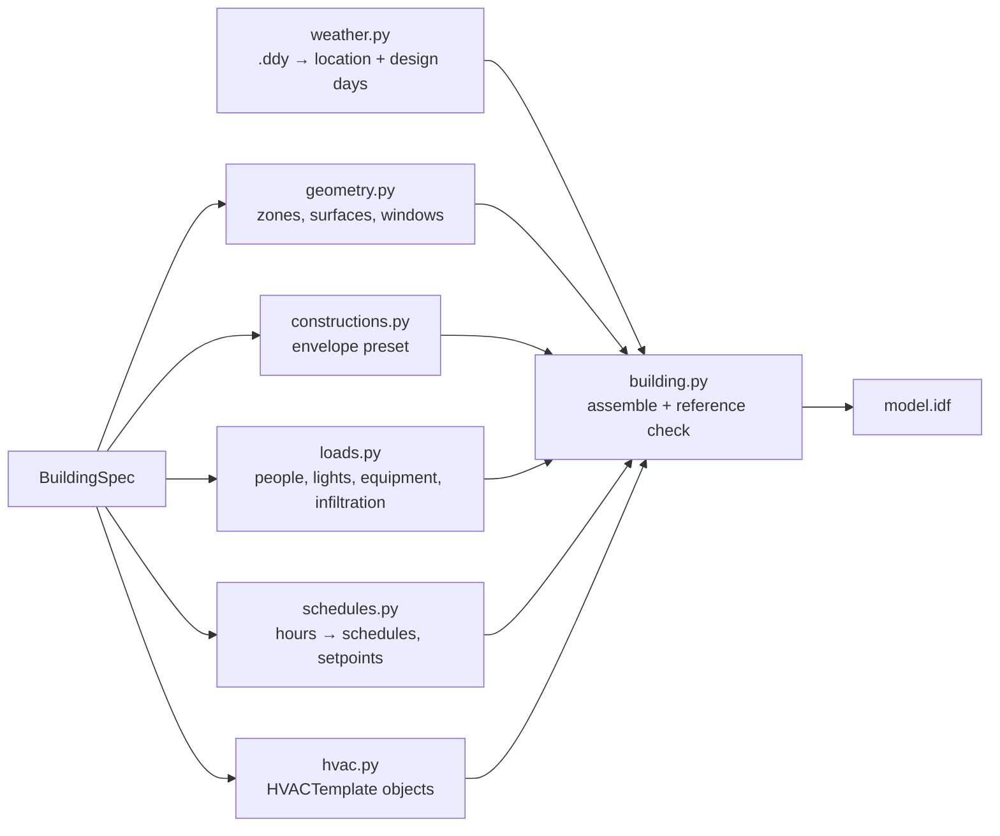
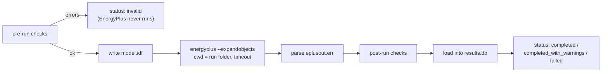
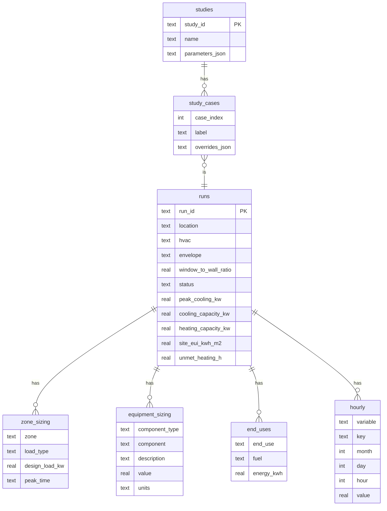
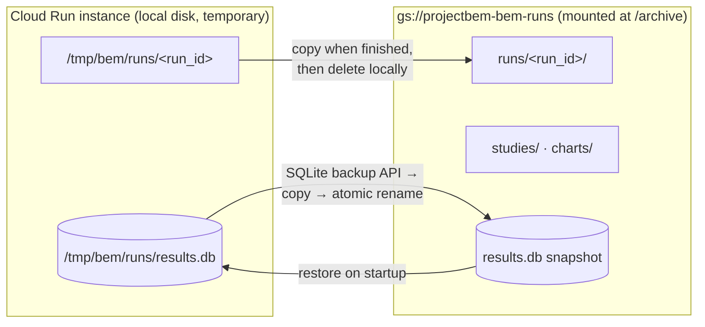
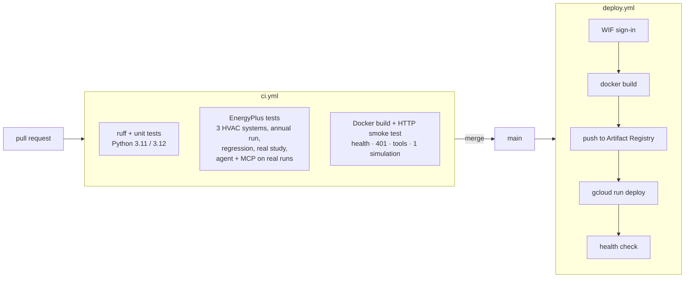

# Architecture

How `bem_agent` is put together: what each part does, how a question becomes an
EnergyPlus simulation and an answer, where data lives, how it is deployed, and why it is
built this way.

**Contents**

1. [The big picture](#1-the-big-picture)
2. [One request, end to end](#2-one-request-end-to-end)
3. [Package layout](#3-package-layout)
4. [The layers](#4-the-layers)
   - [4.1 LLM layer](#41-llm-layer-bem_agentllm)
   - [4.2 Agent loop](#42-agent-loop-bem_agentagentpy)
   - [4.3 Tool registry](#43-tool-registry-bem_agenttoolspy)
   - [4.4 MCP server](#44-mcp-server-bem_agentmcp_serverpy)
   - [4.5 Model builder](#45-model-builder-bem_agentmodel)
   - [4.6 Simulation pipeline](#46-simulation-pipeline-bem_agentsim)
   - [4.7 Verification and validation](#47-verification-and-validation-bem_agentvalidation)
   - [4.8 Results: ETL, queries, charts](#48-results-etl-queries-charts-bem_agentresults)
   - [4.9 Parametric studies](#49-parametric-studies-bem_agentsimparametricpy)
   - [4.10 Storage](#410-storage-bem_agentstoragepy)
5. [Deployment](#5-deployment)
6. [Security and guardrails](#6-security-and-guardrails)
7. [Testing](#7-testing)
8. [Design decisions](#8-design-decisions)
9. [Known limitations](#9-known-limitations)
10. [Extending it](#10-extending-it)

---

## 1. The big picture

The core idea: **the LLM never computes an engineering number.** It reads the question
and decides which tools to call with which inputs. Everything numeric (geometry,
loads, equipment sizes, energy) comes from EnergyPlus, through deterministic code that
validates inputs before a run and checks outputs after it.

The same tools are reachable two ways, and neither needs a specific LLM:



- **Grok** (or any MCP client) connects over HTTPS to the server on Cloud Run.
- **The CLI agent** (`bem-agent`) runs its own tool-calling loop on any LLM provider
  and calls the same tool registry in-process.
- **The server itself never calls an LLM.** Swapping the model changes who decides
  which tools to call, not how numbers are produced.

---

## 2. One request, end to end

A question asked in Grok, e.g. *"Compare VAV and packaged heat pumps for a 3-story,
30,000 ft² office in Washington DC at 30% and 50% window-to-wall ratio."*



What the model sees is a compact summary (a few KB at most), not EnergyPlus output.
The full detail stays in `results.db` and in the run folders, where later tool calls
(`get_run_details`, `query_results`, `make_chart`) can reach it.

---

## 3. Package layout

```
src/bem_agent/
├── llm/                  provider-agnostic chat + tool calling
│   ├── base.py           Message, ToolSpec, ToolCall, LLMClient (retry on 429), errors
│   ├── openai_compat.py  Groq, OpenAI, Gemini, xAI, any OpenAI-compatible server
│   ├── anthropic_client.py  Claude
│   └── config.py         provider presets, get_client(), API-key cleaning
├── agent.py              tool-calling loop, token-budget trimming, CLI (bem-agent)
├── tools.py              the 9 tools: schemas, argument handling, guardrails
├── mcp_server.py         MCP server (stdio / HTTP), API-key middleware (bem-mcp)
├── model/                BuildingSpec → EnergyPlus IDF
│   ├── building.py       BuildingSpec, assembly, simulation + output objects
│   ├── geometry.py       perimeter/core zoning, surfaces, windows
│   ├── constructions.py  envelope presets → materials and constructions
│   ├── loads.py          people, lights, equipment, infiltration
│   ├── schedules.py      operating hours → compact schedules, setpoints
│   ├── hvac.py           HVACTemplate systems written in full
│   ├── _template_fields.py  field names + defaults generated from the 25.1 IDD
│   ├── weather.py        demo cities, .ddy design days
│   └── idf.py            IDF objects: render, parse, reference checks
├── sim/
│   ├── runner.py         run EnergyPlus (subprocess, timeout, own folder)
│   ├── errfile.py        parse eplusout.err
│   ├── pipeline.py       simulate(): validate → build → run → check → load
│   └── parametric.py     ParametricStudy, case matrix, parallel batch runner
├── validation/
│   ├── pre.py            input checks before a run
│   ├── post.py           output checks after a run
│   └── report.py         Issue / ValidationReport
├── results/
│   ├── sql.py            read EnergyPlus's eplusout.sql
│   ├── etl.py            eplusout.sql → results.db, capacities
│   ├── queries.py        compare, time series, read-only SQL
│   └── plots.py          PNG charts + CSV beside each
└── storage.py            local disk ↔ Cloud Storage archive

scripts/   install_energyplus.sh, smoke_mcp.py, update_reference.py, gen_template_fields.py
deploy/    gcp_setup.sh (one-time GCP), mcp.sh (API keys, open, url), gcp.env (identifiers)
.github/workflows/  ci.yml (tests, EnergyPlus, Docker smoke test), deploy.yml (Cloud Run)
```

Dependencies point one way: `agent` and `mcp_server` → `tools` → `sim` / `results` →
`model` / `validation`. Nothing below `tools` knows about LLMs or MCP.



---

## 4. The layers

### 4.1 LLM layer (`bem_agent.llm`)

One neutral format (`Message`, `ToolSpec`, `ToolCall`, `LLMResponse`) and one client
per wire protocol. The agent loop only sees the neutral types.

| Provider (`BEM_LLM_PROVIDER`) | Client | Default model |
|---|---|---|
| `groq` (default, free tier) | OpenAI-compatible | `openai/gpt-oss-120b` |
| `anthropic` | Anthropic Messages API | `claude-sonnet-5-5` |
| `gemini` | OpenAI-compatible | `gemini-3.5-flash` |
| `openai` | OpenAI-compatible | set `BEM_LLM_MODEL` |
| `openai_compatible` (xAI, OpenRouter, vLLM, Ollama) | OpenAI-compatible | set `BEM_LLM_MODEL` + `BEM_LLM_BASE_URL` |

Behavior shared by every provider:

- **Rate limits:** HTTP 429 is retried with backoff, honoring `Retry-After`.
- **Readable errors:** other 4xx responses become `LLMRequestError` with the
  provider's own reason. Groq's `tool_use_failed` (it rejects a tool call that
  doesn't match the schema) becomes `ToolUseFailed`, which the agent can recover from.
- **Malformed tool arguments** are flagged on the `ToolCall` instead of crashing.
- **API keys are cleaned** of whitespace, quotes and terminal escape codes (a pasted
  key once carried `ESC [ A` from an arrow key and broke every request).

### 4.2 Agent loop (`bem_agent/agent.py`)



- **System prompt:** every number must come from a tool result; convert units; check
  each run's status; compare HVAC systems on capacity and EUI, not zone loads; report
  differences in %; name assumptions.
- **Token budget** (default 6,000 input tokens, for Groq's 8K tokens/minute free tier):
  first shorten older tool results to 300 characters, then drop the oldest whole
  exchanges (an assistant tool call and its results together). The system prompt, the
  question and the latest exchange are never dropped.
- **CLI:** one-shot or interactive with follow-ups; each step is printed; a transcript
  (question, every tool call and result, token usage) is saved to `runs/transcripts/`.

### 4.3 Tool registry (`bem_agent/tools.py`)

The single source of truth for what an LLM can do. Both the agent loop and the MCP
server use it.

| Tool | Purpose | Notes |
|---|---|---|
| `list_options` | cities, HVAC systems, presets, study parameters, units | cheap discovery |
| `run_simulation` | one building → one EnergyPlus run | returns peaks, capacity, EUI |
| `run_parametric_study` | every combination of options, in parallel | best case, main effects |
| `get_run_details` | `issues`, `zone_loads`, `equipment`, `end_uses` | for one run |
| `compare_runs` | several runs side by side | optional sort |
| `get_timeseries` | daily / monthly / annual series | annual runs only |
| `query_results` | one read-only `SELECT` | schema in the description |
| `make_chart` | PNG + CSV | returned as an image over MCP |
| `list_history` | earlier runs, studies, a study's cases | |

Key choices:

- **Flat, compact building schema.** About 1,500 tokens for all tool schemas, because
  they are sent with every LLM call.
- **Two schema views.** MCP clients get strict schemas (enums, ranges). The LLM in the
  agent loop gets *relaxed* schemas, with allowed values moved into descriptions:
  Groq rejects a whole request when a tool call breaks an enum (e.g. "Washington DC" for
  `washington_dc`), so our own validators enforce the values instead, with messages the
  model can act on.
- **Location normalization.** "Washington, D.C." and "San Francisco, CA" map to the
  bundled weather files; nothing else is accepted, so the model never picks file paths.
- **Errors are data.** `execute()` never raises for something the model could fix; it
  returns `{"error": "..."}`. Results are compact JSON capped at 4,000 characters.
- **Budget.** Each session (each API key, on the server) may run 60 simulations;
  runs stopped by pre-run checks are refunded.

### 4.4 MCP server (`bem_agent/mcp_server.py`)

Built on the low-level MCP Python SDK (v2): `on_list_tools` and `on_call_tool` map
directly onto the registry.

- **Transports:** stdio for local clients, streamable HTTP (`/mcp`, stateless, JSON
  responses) for remote ones.
- **Off the event loop:** tool calls run in worker threads (`anyio.to_thread`), since
  simulations block for seconds to minutes.
- **Charts** come back as MCP image content (base64 PNG) next to the JSON.
- **Authentication:** an ASGI middleware in front of the MCP app.



- Keys come from `BEM_MCP_KEYS`, a JSON map of name → key (at least 24 characters),
  stored in Secret Manager. Accepted forms: `Authorization: Bearer <key>`, a bare key in
  `Authorization`, or `X-API-Key: <key>`. Comparison is constant-time, across all keys.
- `/.well-known/*` answers 404 on purpose: MCP clients that get a 401 go looking for
  OAuth metadata, and a clear "none" makes them use the header instead of a sign-in.
- The server **refuses to start** on a public interface without keys.

### 4.5 Model builder (`bem_agent.model`)

`BuildingSpec` (pydantic) → a complete, runnable EnergyPlus 25.1 IDF.



- **Geometry:** a rectangular footprint (or total area + aspect ratio), split per floor
  into 4 perimeter zones and a core (one zone per floor if too small). Walls between
  zones and floors between stories are adiabatic, a standard simplification for load
  and sizing studies. Orientation goes through the Building object's north axis, so the
  geometry itself stays axis-aligned. Windows are centered strips sized to hit the
  window-to-wall ratio exactly.
- **Envelope, loads, schedules:** named presets (`efficient` / `typical` / `older`;
  `office` / `retail` / `data_heavy_office`; `office` / `retail` / `24_7`) or custom
  values. Schedules are generated from operating hours. Design days follow standard
  load-calculation practice: the summer design day has full weekday internal gains; the
  winter design day has none.
- **HVAC:** `HVACTemplate` objects (ideal loads; VAV with air-cooled chiller, gas boiler
  and hot-water reheat; packaged terminal heat pumps), expanded by EnergyPlus's
  `--expandobjects`. ExpandObjects ignores IDD defaults, so every template object is
  written out in full from a field table generated from the 25.1 IDD
  (`scripts/gen_template_fields.py`). Ideal loads gets explicit `Sizing:Zone` objects
  (its template creates none).
- **Weather:** five bundled cities (Chicago, San Francisco, Golden CO, Tampa,
  Washington DC); location and the 99.6 % heating / 0.4 % cooling design days are read
  from the city's `.ddy` file.
- **IDF writer:** our own (`idf.py`), not eppy, which needs the IDD at runtime. Every
  model is checked for broken name references (constructions, schedules, zones,
  templates) before it is written.

### 4.6 Simulation pipeline (`bem_agent.sim`)

`simulate(spec)` is the one entry point the tools use:



- Each run gets its own folder: `spec.json`, `model.idf`, EnergyPlus outputs
  (`eplusout.sql`, `.err`, tables), `run.json` (the summary and both validation
  reports).
- EnergyPlus runs **inside its run folder**: ExpandObjects writes temporary files to
  the working directory, and parallel runs sharing one directory collided.
- Run IDs look like `20261121T055240_wwr-30-vav_583519` (time, readable slug, random
  suffix).

### 4.7 Verification and validation (`bem_agent.validation`)

The goal: the agent can never report numbers from a broken model.

| Stage | Check | Level |
|---|---|---|
| Pre-run | occupied cooling setpoint ≥ heating + 1 °C; setbacks the right way round | error |
| Pre-run | weather file resolves; model has no broken references | error |
| Pre-run | aspect ratio > 5, WWR > 60 %, lighting > 16 W/m², equipment > 40 W/m², > 0.5 people/m², never occupied, > 60 zones | warning |
| Post-run | EnergyPlus completed, 0 severe errors, no timeout, SQLite written | error |
| Post-run | every zone has sizing results | error |
| Post-run | a zone with zero cooling load | warning |
| Post-run | peak cooling 15–250 W/m², heating 5–250 W/m² | warning |
| Post-run | site EUI 50–800 kWh/m²; unmet hours ≤ 300 (annual runs) | warning |
| Regression | a fixed reference office's peak loads within ±2 % | CI test |

These checks have already caught real modeling bugs: ideal loads reporting zero loads
(no `Sizing:Zone`), the winter design day understating heating (internal gains left
on), and a ground-floor core with no cooling load (uninsulated slab). Each became a fix
plus a test.

### 4.8 Results: ETL, queries, charts (`bem_agent.results`)

**ETL** reads each run's `eplusout.sql` (plus `spec.json` and `run.json`), cleans it,
and loads one shared database:



- **Transforms:** joules → kWh, GJ → kWh; weather-file period only (warmup and design
  days dropped); zone names normalized; failed and invalid runs still recorded.
- **Installed capacity** (`cooling_capacity_kw`, `heating_capacity_kw`): chillers if
  present, else cooling coils; boilers, else heat-pump coils, else other heating coils.
  Zone design loads are what the rooms need and are identical for every HVAC system;
  capacity includes ventilation air and fan heat and is what tells systems apart.
- **Queries:** `compare_runs`, `study_table`, `equipment_sizes`, `end_uses`,
  `timeseries` (sum for energy, mean for temperature, per zone or across zones), and
  `run_sql` for the agent: read-only connection, `PRAGMA query_only`, one statement,
  `SELECT`/`WITH` only, no write keywords, row cap.
- **Charts:** matplotlib PNGs following one chart spec (single y-axis, fixed categorical
  colors per run, legend above the plot for 2+ series), each with a CSV of the same
  numbers beside it.

### 4.9 Parametric studies (`bem_agent/sim/parametric.py`)

- A `ParametricStudy` is a base `BuildingSpec` plus `{parameter: [values]}`. Only
  whitelisted parameters may vary (HVAC, WWR, orientation, size, presets, single
  envelope/load values), at most 8 values each and 48 cases in total.
- **Every case is validated before any simulation starts**, so a bad value fails the
  whole study immediately rather than halfway.
- **Parallel:** a thread pool around EnergyPlus subprocesses (`BEM_MAX_WORKERS`,
  default: usable CPUs, max 4). Results are loaded into SQLite from the coordinating
  thread only, so the database never has concurrent writers. One failing case never
  stops the others.
- **Summary:** completed/failed counts, best case per metric, and **main effects**: the
  mean of each metric for each value of each parameter, averaged over the others (e.g.
  "50 % glazing → +12 kW cooling capacity on average").

### 4.10 Storage (`bem_agent/storage.py`)

EnergyPlus and SQLite need a real filesystem (random writes, file locks), which a Cloud
Storage FUSE mount doesn't provide. So on Cloud Run:



Locally (`BEM_ARCHIVE_DIR` unset) every storage function is a no-op. Lookups of a run
check the local folder first, then the archive, so runs from before a restart are
still readable.

---

## 5. Deployment

### Cloud resources (project `projectbem`, region `us-east1`)

| Resource | Name | Purpose |
|---|---|---|
| Cloud Run service | `bem-mcp` | the MCP server (gen2, 2 CPU, 4 GiB, max 1 instance, scales to zero) |
| Artifact Registry | `bem-agent` | container images, tagged by commit |
| Cloud Storage bucket | `projectbem-bem-runs` | archived runs, charts, `results.db` snapshots |
| Secret Manager | `BEM_MCP_KEYS` | API keys (name → key) |
| Secret Manager | `GROQ_API_KEY` | for the CLI agent only; Cloud Run doesn't use it |
| Service account | `bem-runtime` | what Cloud Run runs as: its bucket + the keys secret only |
| Service account | `bem-deployer` | what GitHub deploys as: push images, deploy Cloud Run |
| Workload Identity Federation | pool `github`, provider `bem-agent-repo` | GitHub signs in without key files; this repo's `main` only |

Endpoint: `https://bem-mcp-155789354610.us-east1.run.app/mcp`

### Pipeline



- **Image:** `python:3.12-slim` + EnergyPlus 25.1 trimmed to what the server uses
  (docs, example files and other cities' weather removed), non-root user, 634 MB.
- **Access:** Cloud Run's own Google-account check is disabled (`--no-invoker-iam-check`,
  done once by `deploy/mcp.sh open`), because Grok can't send Google identity tokens;
  the server's API-key middleware is the gate.
- **Max 1 instance:** one instance owns `results.db`, and it caps cost. Scales to zero;
  CPU is billed only while a request runs.

### Operations

| Task | Command |
|---|---|
| Add a key for someone | `bash deploy/mcp.sh add <name>` (printed once) |
| Revoke a key | `bash deploy/mcp.sh remove <name>` |
| List key names | `bash deploy/mcp.sh list` |
| Connector URL | `bash deploy/mcp.sh url` |
| Check the live service | `BEM_MCP_KEY=<key> python scripts/smoke_mcp.py https://bem-mcp-155789354610.us-east1.run.app` |
| Recent server logs | `gcloud logging read 'resource.labels.service_name="bem-mcp"' --project projectbem --limit 30 --format='value(textPayload)'` |
| Redeploy | merge to `main`, or run the Deploy workflow manually |

Key changes add a secret version, disable the old ones (a revoked key can't come back
from history) and restart the service so it loads the new list.

---

## 6. Security and guardrails

| Risk | Control |
|---|---|
| Strangers running simulations on your bill | API key on every request; 401 before any tool; max 1 instance |
| A leaked key | one key per person, revocable on its own; usage logged by key name |
| Guessing keys | ≥ 24 characters (generated: 43); constant-time comparison |
| Keys in logs | rejection logs record header names, scheme and length only |
| The model reading arbitrary files | locations limited to bundled weather files; run IDs validated (no `/`, `..`) |
| The model changing data | read-only SQL: read-only connection, `query_only`, one `SELECT`, keyword filter, row cap |
| Runaway usage | per-key simulation budget (60), study cap (48 cases), EnergyPlus timeout, step limit in the agent |
| Invented numbers | system prompt + tool design: every number comes from a tool result; results carry status and issues |
| Cloud credentials | no key files anywhere: GitHub uses Workload Identity Federation; service accounts have only what they need |

---

## 7. Testing

About 120 unit tests plus 15 EnergyPlus tests, all in CI.

| Level | What it covers | Needs |
|---|---|---|
| Unit | geometry (areas, WWR, every surface faces outward via Newell normals), schedules, IDF writer and reference checks, `.err` parsing, validation rules, ETL on a synthetic `eplusout.sql`, read-only SQL, parametric expansion and main effects, tool arguments and errors, LLM clients with fake SDKs, agent loop with a scripted LLM, MCP via an in-process client, HTTP auth against a live uvicorn server | nothing |
| EnergyPlus | sizing runs for all 3 HVAC systems, an annual run with ETL and charts, the ±2 % regression case, a 6-case parallel study, the agent and the MCP server driving real runs | EnergyPlus (CI installs it) |
| Image | build the Docker image, start it, smoke-test over HTTP | Docker (CI) |
| Live LLM | one real question to Groq | `GROQ_API_KEY` repo secret (optional) |

---

## 8. Design decisions

| Decision | Why | Trade-off |
|---|---|---|
| MCP server with no LLM inside | any client can be the brain (Grok, Claude, a CLI on Groq); numbers never depend on a model | the client's model quality shapes the conversation |
| One tool registry for MCP and the CLI | one set of schemas, validation and guardrails | relaxed vs strict schema views to manage |
| Groq free tier as the default LLM | free, fast, good enough for tool calling | 8K tokens/min drives compact schemas and trimming |
| Write IDF directly, not eppy | no IDD at runtime; full control and tests | EnergyPlus is the final validity check (CI runs it) |
| `HVACTemplate` + ExpandObjects | real systems from a few objects | templates must be written in full (generated field table) |
| Rectangular perimeter/core geometry, adiabatic partitions | fast, standard for sizing and comparisons | not for detailed geometry or daylighting |
| Compare HVAC on installed capacity and EUI | zone loads are system-independent by definition | capacity selection rules are heuristic per component type |
| SQLite results database | zero ops; SQL the agent can query | one writer; on Cloud Run it needs local disk + snapshots |
| API keys, not OAuth | Grok's connector sends a header; simple to manage | no per-user sign-in flow (Claude connectors need OAuth; skipped) |
| Cloud Run, max 1 instance | scale to zero, cheap, simple state | no horizontal scaling; long studies hold the instance |

---

## 9. Known limitations

- **Geometry:** rectangles only; adiabatic interior partitions and floors; no
  daylighting, shading devices or detailed constructions.
- **HVAC:** three template systems; no economizer controls, DOAS, VRF or
  ground-source options yet.
- **Weather:** five bundled cities; other locations need their `.epw` + `.ddy` added
  to the image and the city list.
- **Scale:** one Cloud Run instance; a 48-case annual study takes minutes and blocks
  that instance's workers.
- **Budgets** are per key per instance lifetime and reset when the instance restarts.
- **Answer quality depends on the client's model.** The MCP server's own instructions
  are shorter than the CLI's system prompt, so a connector like Grok may skip
  interpretation guidance (e.g. calling a 3–4 % difference "roughly equal").

---

## 10. Extending it

| To add | Where |
|---|---|
| A city | `model/weather.py` (`CITIES`), Dockerfile weather filter, `tools.LOCATION_ALIASES` |
| An HVAC system | `model/hvac.py` (`HVACSystem` + template objects); `scripts/gen_template_fields.py` for new template types; capacity rules in `results/etl.py` |
| A preset | `ENVELOPE_PRESETS`, `LOAD_PRESETS` or `SCHEDULE_PRESETS` |
| A study parameter | `sim/parametric.py` (`PARAMETERS`) |
| A tool | a function + `Tool(...)` entry in `tools.py`; it appears in MCP and the CLI automatically |
| An LLM provider | a preset in `llm/config.py` (OpenAI-compatible), or a new client next to `anthropic_client.py` |
| A validation rule | `validation/pre.py` or `validation/post.py`, with a test |
| An hourly output | `Output:Meter` / `Output:Variable` in `model/building.py`, `HOURLY_SERIES` in `results/etl.py`, `HOURLY_VARIABLES` in `tools.py` |
